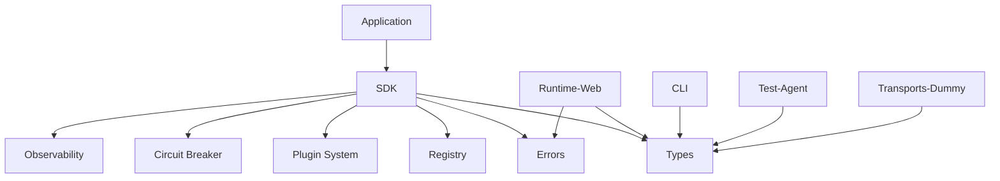

# AgentKit SDK Architecture Overview

## Design Philosophy

AgentKit SDK is built around three foundational principles that guide all architectural decisions:

### 1. Separation of Concerns

Each package has a single, well-defined responsibility:
- **SDK**: Agent lifecycle management and API surface
- **Registry**: Dynamic registration and lookup with immutable data
- **Types**: Shared interfaces and Zod validation schemas
- **Runtime-Web**: Browser-specific implementations and Web Worker support
- **CLI**: Development tools for plugin scaffolding and signing
- **Transports**: Message passing abstractions
- **Test utilities**: Development and testing support

This separation ensures that changes in one area don't cascade through the system, making the SDK more maintainable and extensible.

### 2. Agent Agnosticism

AgentKit makes no assumptions about:
- AI providers (OpenAI, Anthropic, local models)
- Agent implementations (chatbots, task agents, data processors)
- Message formats or protocols
- Execution environments (browser, Node.js, serverless)

This flexibility allows developers to integrate any agent implementation while maintaining consistent lifecycle management.

### 3. Developer Experience First

All APIs prioritize:
- **Type Safety**: Comprehensive TypeScript with runtime validation
- **Debugging**: Rich observability hooks and debug logging
- **Testing**: Built-in test utilities and resource management
- **Documentation**: Self-documenting code with clear examples

## System Architecture

```
┌─────────────────┐    ┌──────────────────┐    ┌─────────────────┐
│   Application   │    │   AgentKit SDK   │    │   AI Agents     │
│                 │    │                  │    │                 │
│ ┌─────────────┐ │    │ ┌──────────────┐ │    │ ┌─────────────┐ │
│ │Your Business│ │───▶│ │ Agent        │ │───▶│ │ OpenAI      │ │
│ │Logic        │ │    │ │ Management   │ │    │ │ Anthropic   │ │
│ └─────────────┘ │    │ └──────────────┘ │    │ │ Custom LLMs │ │
│                 │    │        │         │    │ └─────────────┘ │
│ ┌─────────────┐ │    │        ▼         │    │                 │
│ │Transport    │ │◀───│ ┌──────────────┐ │    │ ┌─────────────┐ │
│ │Layer        │ │    │ │ Transport    │ │    │ │ Transport   │ │
│ └─────────────┘ │    │ │ Abstraction  │ │    │ │ Adapters    │ │
└─────────────────┘    │ └──────────────┘ │    │ └─────────────┘ │
                       │                  │    └─────────────────┘
                       │ ┌──────────────┐ │
                       │ │ Observability│ │
                       │ │ & Security   │ │
                       │ └──────────────┘ │
                       └──────────────────┘
```

## Package Dependencies



## Core Components

### Agent Lifecycle Management
- **Initialization**: Agent setup with configuration validation
- **Request Handling**: Message processing with error boundaries
- **Resource Management**: Automatic cleanup and leak prevention
- **Shutdown**: Graceful termination with resource deallocation

### Transport Abstraction
- **Protocol Independence**: HTTP, WebSocket, Message Queue support
- **Backpressure Management**: Queue limits and flow control
- **Health Monitoring**: Transport status and capacity reporting
- **Browser Compatibility**: Web Worker isolation and polyfills

### Plugin System
- **Secure Execution**: Deep cloning and sandbox isolation
- **Lifecycle Hooks**: Init, send, error, and shutdown events
- **HMAC Verification**: Cryptographic plugin authenticity
- **Permission Model**: Granular access control

### Observability Framework
- **Request Tracing**: Unique request IDs and timing
- **Performance Metrics**: Duration, memory, and resource usage
- **Error Context**: Structured error reporting with stack traces
- **Debug Logging**: Configurable verbosity levels

## Security Model

### Plugin Sandboxing
- **Deep Cloning**: Prevent context mutation between plugins
- **Timeout Protection**: Configurable execution time limits
- **Resource Isolation**: Memory and CPU usage boundaries
- **VM Execution**: Isolated JavaScript execution contexts

### Data Immutability
- **Registry Protection**: Deep-frozen agent and transport metadata
- **Configuration Safety**: Immutable options once set
- **State Management**: Atomic updates with mutex protection

### Input Validation
- **Runtime Schemas**: Zod validation for all external data
- **Type Safety**: TypeScript compilation with strict mode
- **Sanitization**: Clean user inputs before processing

## Performance Characteristics

### Concurrency Control
- **Bounded Execution**: Configurable request limits
- **Queue Management**: FIFO processing with backpressure
- **Circuit Breaker**: Automatic failure detection and recovery
- **Resource Pooling**: Efficient connection management

### Memory Management
- **Automatic Cleanup**: Timer and event listener disposal
- **Leak Detection**: Handle tracking and monitoring
- **GC Optimization**: Minimal object allocation patterns
- **Resource Limits**: Configurable memory and payload constraints

## Browser Compatibility

### Web Worker Support
- **Plugin Isolation**: Secure execution in separate threads
- **Message Passing**: Structured data serialization
- **Error Boundaries**: Worker failure isolation
- **Performance**: Non-blocking UI thread execution

### Polyfill Strategy
- **Feature Detection**: Runtime capability checking
- **Graceful Degradation**: Fallback implementations
- **Bundle Optimization**: Tree-shaking unused polyfills
- **Cross-Browser**: Chrome, Firefox, Safari, Edge support

## Extension Points

### Custom Agents
- Implement `Agent` interface with lifecycle methods
- Register with metadata including supported scopes
- Provide factory function for instantiation

### Custom Transports
- Implement `Transport` interface with send/receive methods
- Support backpressure with `canAcceptMore()` method
- Provide health status reporting

### Plugin Development
- Implement `AgentKitPlugin` interface with optional hooks
- Use CLI tools for scaffolding and signing
- Follow security guidelines for safe execution

This architecture provides a solid foundation for building production-grade AI agent applications with security, performance, and maintainability at its core.