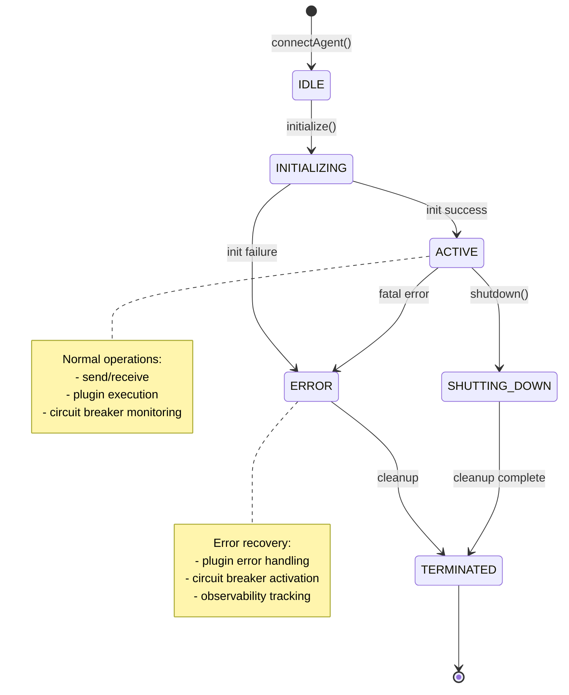

# Agent Lifecycle Sequence Diagram

This diagram illustrates the complete agent lifecycle from initial connection through active operation to graceful shutdown, showing all component interactions and state transitions.

## Agent Lifecycle Sequence Diagram

```mermaid
sequenceDiagram
    participant App as Application
    participant SDK as connectAgent
    participant REG as AgentRegistry
    participant MGR as AgentManager
    participant EXE as BoundedExecutor
    participant CB as CircuitBreaker
    participant PM as PluginManager
    participant SB as Sandbox
    participant AL as AgentLifecycle
    participant A as Agent
    participant T as Transport
    participant OBS as ObservabilityTracker
    participant RH as RuntimeHandle
    
    %% Phase 1: Connection & Validation
    Note over App,RH: Phase 1: Connection & Validation
    App->>SDK: connectAgent(options)
    SDK->>SDK: validate options schema
    SDK->>REG: lookup(agentId)
    REG-->>SDK: AgentMetadata
    SDK->>REG: lookupTransport(transportId)
    REG-->>SDK: Transport
    SDK->>SDK: compatibility check
    
    %% Phase 2: Manager Creation & Component Initialization
    Note over App,RH: Phase 2: Manager Creation & Initialization
    SDK->>MGR: new AgentManager(agent, transport, options)
    MGR->>EXE: new BoundedExecutor(limits)
    MGR->>CB: new CircuitBreaker(config)
    MGR->>PM: new PluginManager(options)
    MGR->>AL: new AgentLifecycle(agent, transport)
    MGR->>OBS: new ObservabilityTracker()
    
    %% Phase 3: Plugin Registration & Verification
    Note over App,RH: Phase 3: Plugin Registration & Verification
    loop for each plugin
        PM->>PM: verifySignature(plugin)
        PM->>SB: createSandbox(plugin)
        SB-->>PM: sandboxEnvironment
        PM->>PM: registerPlugin(plugin, sandbox)
    end
    
    %% Phase 4: Agent & Transport Initialization
    Note over App,RH: Phase 4: Agent & Transport Initialization
    MGR->>AL: initialize()
    AL->>OBS: requestStart(initRequest)
    AL->>T: init(config)
    activate T
    T-->>AL: initialized
    AL->>A: init(config)
    activate A
    A-->>AL: initialized
    
    %% Phase 5: Plugin Lifecycle Hooks
    AL->>PM: callPluginHook('onInit', context)
    loop for each registered plugin
        PM->>SB: executeInSandbox(plugin.onInit, context)
        SB-->>PM: result
    end
    PM-->>AL: all plugins initialized
    
    AL-->>MGR: initialization complete
    MGR->>MGR: setState(ACTIVE)
    AL->>OBS: requestEnd(initRequest, success)
    MGR-->>SDK: AgentManager instance
    SDK->>RH: new RuntimeHandle(manager)
    SDK-->>App: RuntimeHandle
    
    %% Phase 6: Active Operation (Send Request)
    Note over App,RH: Phase 6: Active Operation
    App->>RH: send(input)
    RH->>MGR: send(input)
    MGR->>OBS: requestStart(sendRequest)
    MGR->>EXE: execute(sendOperation)
    EXE->>CB: execute(operation)
    
    %% Circuit Breaker Check
    alt Circuit Breaker CLOSED
        CB->>PM: callPluginHook('onSend', payload, context)
        loop for each plugin
            PM->>SB: executeInSandbox(plugin.onSend, payload, context)
            SB-->>PM: modified payload
        end
        PM-->>CB: processed payload
        
        CB->>A: handle(input)
        A-->>CB: output
        
        CB->>T: canAcceptMore()
        alt Transport Available
            CB->>T: send(output)
            T-->>CB: sent
        else Transport Backpressure
            CB->>EXE: enqueue(output)
            Note over EXE: Retry with exponential backoff
        end
        
        CB-->>EXE: success
        CB->>CB: recordSuccess()
    else Circuit Breaker OPEN
        CB-->>EXE: CircuitBreakerError
        Note over CB: Fast fail - circuit open
    end
    
    EXE-->>MGR: result/error
    MGR->>OBS: requestEnd(sendRequest, result)
    MGR-->>RH: result/error
    RH-->>App: result/error
    
    %% Phase 7: Error Handling (if error occurs)
    Note over App,RH: Phase 7: Error Handling (when errors occur)
    opt On Error
        MGR->>PM: callPluginHook('onError', error, context)
        loop for each plugin
            PM->>SB: executeInSandbox(plugin.onError, error, context)
            SB-->>PM: error handled
        end
        PM-->>MGR: error processed
        
        alt Retryable Error
            MGR->>CB: recordFailure()
            CB->>CB: check failure threshold
            opt Threshold Exceeded
                CB->>CB: setState(OPEN)
                CB->>OBS: circuitBreakerStateChange(OPEN)
            end
        end
    end
    
    %% Phase 8: Graceful Shutdown
    Note over App,RH: Phase 8: Graceful Shutdown
    App->>RH: shutdown()
    RH->>MGR: shutdown()
    MGR->>MGR: setState(SHUTTING_DOWN)
    MGR->>OBS: requestStart(shutdownRequest)
    
    %% Plugin Shutdown Hooks
    MGR->>PM: callPluginHook('onShutdown', context)
    loop for each plugin
        PM->>SB: executeInSandbox(plugin.onShutdown, context)
        SB-->>PM: shutdown complete
    end
    PM-->>MGR: all plugins shutdown
    
    %% Component Cleanup
    MGR->>AL: shutdown()
    AL->>A: shutdown()
    deactivate A
    AL->>T: shutdown()
    deactivate T
    AL-->>MGR: lifecycle shutdown complete
    
    MGR->>EXE: shutdown()
    EXE->>EXE: drain queue & cleanup
    EXE-->>MGR: executor shutdown
    
    MGR->>CB: shutdown()
    CB-->>MGR: circuit breaker shutdown
    
    MGR->>PM: shutdown()
    PM->>SB: destroySandbox()
    SB-->>PM: sandbox destroyed
    PM-->>MGR: plugin manager shutdown
    
    MGR->>OBS: requestEnd(shutdownRequest, success)
    MGR->>MGR: setState(TERMINATED)
    MGR-->>RH: shutdown complete
    RH-->>App: shutdown complete
    
    %% Styling for different phases
    rect rgb(240, 248, 255)
        Note over App,RH: Connection & Validation Complete
    end
    rect rgb(248, 255, 240)
        Note over App,RH: Active Operation Complete
    end
    rect rgb(255, 248, 240)
        Note over App,RH: Graceful Shutdown Complete
    end
```

## Lifecycle State Transitions

## Key Lifecycle Phases

### **Phase 1: Connection & Validation**
- Schema validation of connection options
- Agent and transport resolution from registry
- Compatibility verification between agent and transport

### **Phase 2: Manager Creation & Initialization**
- BoundedExecutor setup with resource limits
- CircuitBreaker configuration for fault tolerance  
- PluginManager initialization with security settings
- ObservabilityTracker setup for monitoring

### **Phase 3: Plugin Registration & Verification**
- HMAC signature verification for each plugin
- Sandbox environment creation (VM/WebWorker)
- Plugin registration with security validation

### **Phase 4: Agent & Transport Initialization**
- Transport layer initialization with configuration
- Agent initialization with configuration
- Observability request tracking throughout

### **Phase 5: Plugin Lifecycle Hooks**
- onInit hooks called for all registered plugins
- Secure sandboxed execution of plugin code
- Context sharing with deep cloning for security

### **Phase 6: Active Operation**
- Request processing through BoundedExecutor
- Circuit breaker protection against failures
- Plugin onSend hooks for request processing
- Transport backpressure handling with retry logic
- Success/failure tracking for circuit breaker

### **Phase 7: Error Handling**
- Plugin onError hooks for error processing
- Circuit breaker failure recording and state management
- Observability tracking of error conditions
- Retry logic for transient failures

### **Phase 8: Graceful Shutdown**
- Plugin onShutdown hooks for cleanup
- Agent and transport shutdown procedures
- Resource cleanup and queue draining
- State transition to TERMINATED

## Critical Design Patterns

- **State Machine**: Clear lifecycle state transitions with validation
- **Circuit Breaker**: Automatic failure detection and recovery
- **Plugin Isolation**: Secure sandbox execution with timeout protection
- **Observability**: Comprehensive request tracking and metrics
- **Resource Management**: Bounded execution with cleanup guarantees
- **Error Recovery**: Multi-layered error handling with plugin hooks