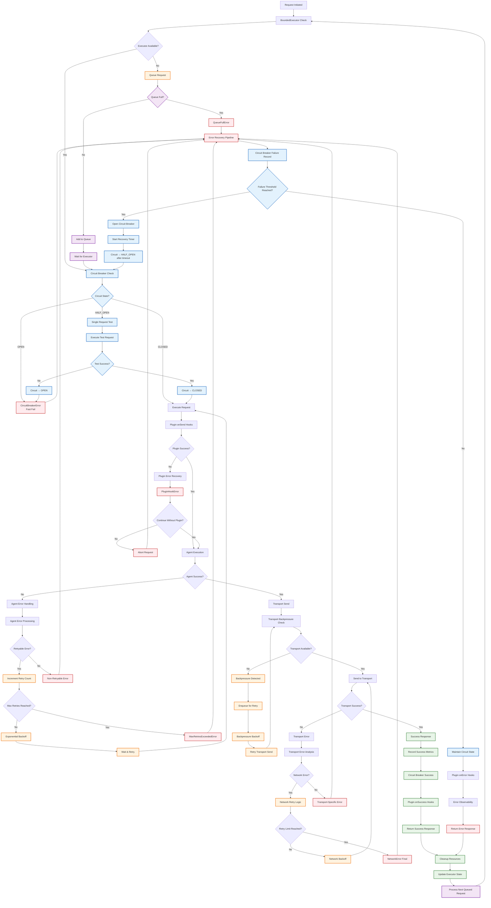
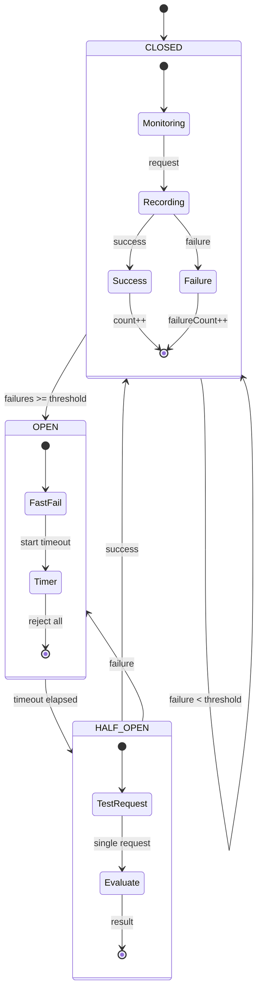
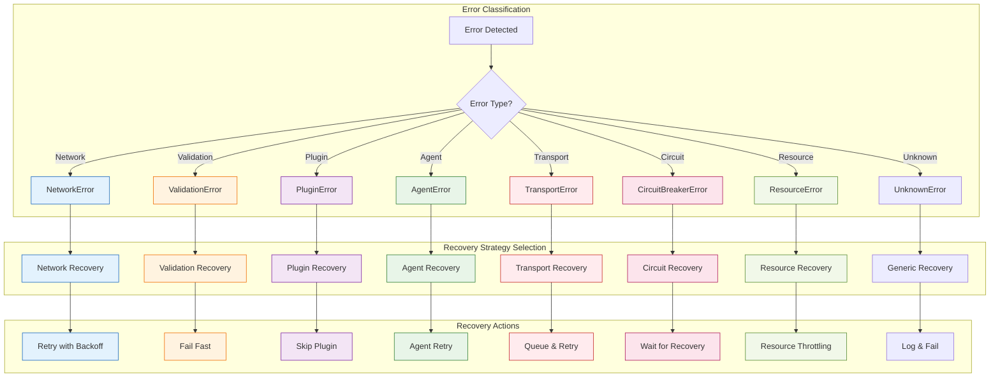
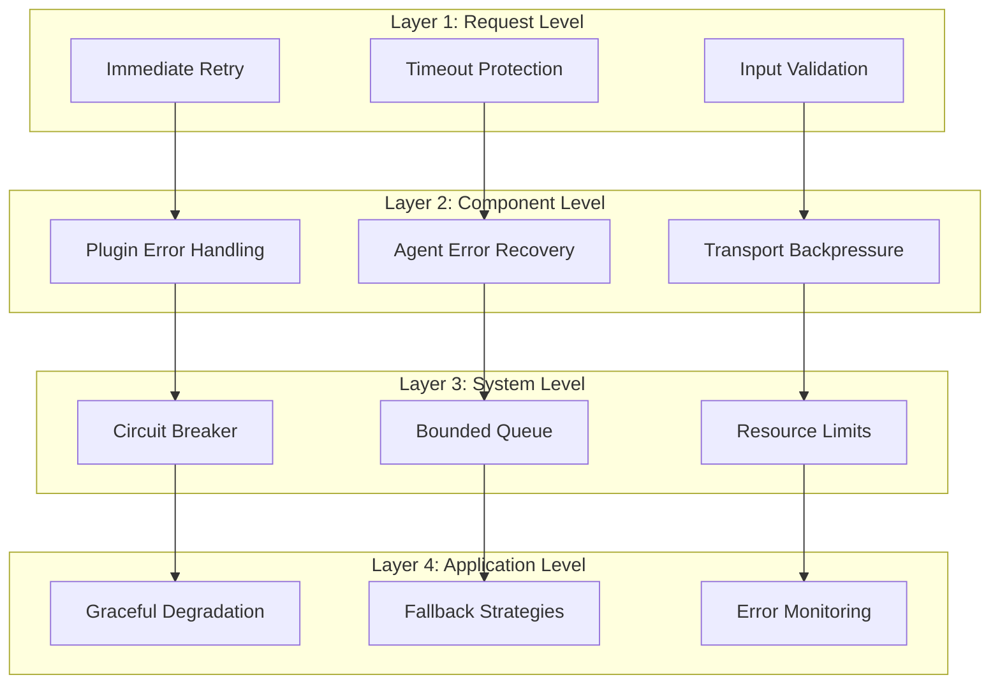
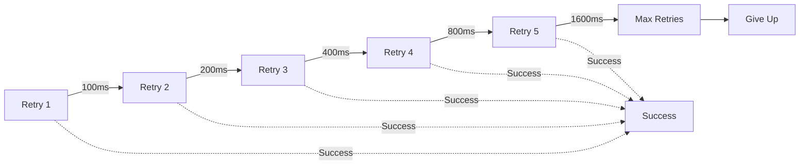
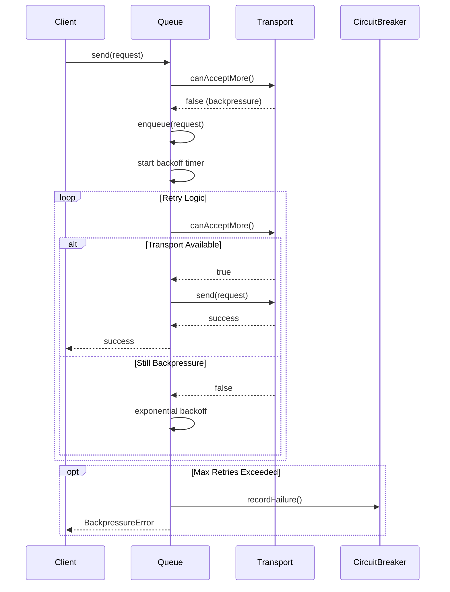

# Error Recovery Flow Diagram

This diagram illustrates the comprehensive error recovery mechanisms in AgentKit SDK, including circuit breaker patterns, backpressure management, retry logic, and multi-layered fault tolerance.

## Error Recovery Flow Diagram

## Circuit Breaker State Machine

## Error Classification & Recovery Strategy

## Multi-Layer Error Recovery Architecture

## Retry Logic & Backoff Strategies

### **Exponential Backoff Configuration**

### **Backpressure Handling**

## Error Recovery Metrics & Observability

### **Key Metrics Tracked**
1. **Circuit Breaker Metrics**
   - State transitions (CLOSED → OPEN → HALF_OPEN)
   - Failure rate and threshold monitoring
   - Recovery time tracking

2. **Retry Metrics**
   - Retry attempt counts per error type
   - Backoff duration effectiveness
   - Success rate after retries

3. **Queue Metrics**
   - Queue depth and processing rate
   - Backpressure frequency and duration
   - Resource utilization patterns

4. **Plugin Error Metrics**
   - Plugin failure rates by type
   - Sandbox violation frequency
   - Plugin execution timeouts

### **Recovery Success Indicators**
- **Circuit Recovery**: Successful transition from OPEN → HALF_OPEN → CLOSED
- **Retry Success**: Request success after retry attempts
- **Backpressure Relief**: Queue processing resumption
- **Plugin Recovery**: Successful plugin execution after failure
- **Transport Recovery**: Successful message delivery after backpressure

## Error Recovery Best Practices

### **Configuration Guidelines**
- **Circuit Breaker**: 5 failures threshold, 60s timeout
- **Retry Logic**: 3 attempts with exponential backoff
- **Queue Limits**: 50 max queue size, 30s request timeout
- **Plugin Timeouts**: 5s for onInit, 2s for onSend
- **Backpressure**: 100ms initial delay, 2x multiplier

### **Monitoring & Alerting**
- Circuit breaker state changes
- High retry rates indicating systemic issues
- Queue depth approaching limits
- Plugin error rate spikes
- Transport backpressure frequency

This comprehensive error recovery system ensures high availability and resilience through multiple layers of fault tolerance, automatic recovery, and intelligent retry mechanisms.