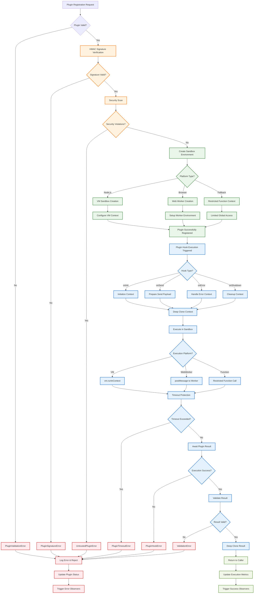
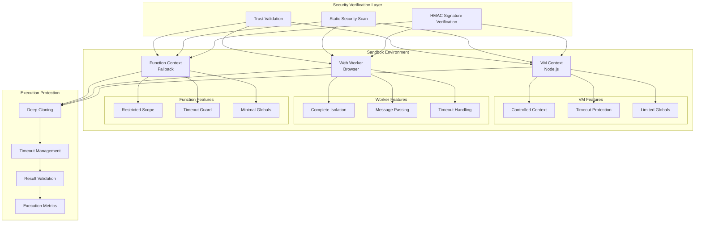
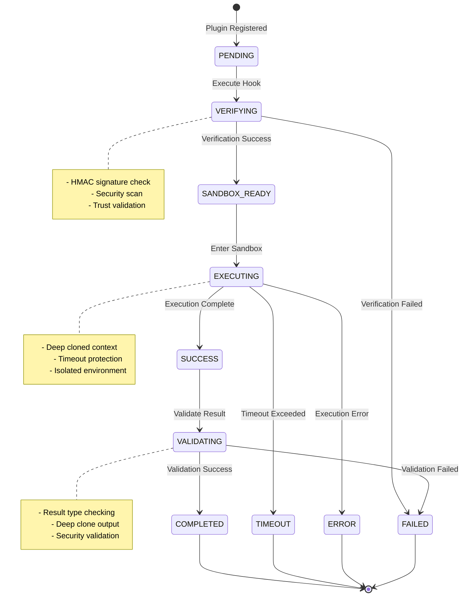
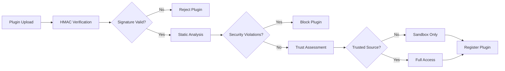

# Plugin Execution Flow Chart

This diagram illustrates the complete plugin execution flow including security verification, sandbox creation, and isolated execution with comprehensive error handling and timeout protection.

## Plugin Execution Flow Chart



## Plugin Security Architecture



## Plugin Hook Execution States



## Security Verification Process

### **1. Plugin Registration Security**


### **2. Sandbox Environment Selection**
- **Node.js VM**: Maximum isolation with `vm.runInContext()`
- **Web Worker**: Browser isolation with message passing
- **Function Context**: Fallback with restricted global access

### **3. Context Protection**
```typescript
// Deep cloning prevents context pollution
const clonedContext = deepClone(context)
const clonedPayload = deepClone(payload)

// Timeout protection prevents infinite loops
const result = await Promise.race([
  pluginHook(clonedPayload, clonedContext),
  timeoutPromise(timeoutMs)
])
```

## Plugin Hook Types & Execution

### **onInit Hook**
- **Purpose**: Plugin initialization after agent setup
- **Context**: Agent metadata, configuration, observability hooks
- **Security**: Full context cloning, initialization-safe operations
- **Timeout**: 5 seconds default

### **onSend Hook**
- **Purpose**: Process/modify requests before sending to agent
- **Context**: Send payload, agent context, request metadata
- **Security**: Payload cloning, input validation, result validation
- **Timeout**: 2 seconds default (performance critical)

### **onError Hook**
- **Purpose**: Error handling and recovery logic
- **Context**: Error object, agent context, failure metadata
- **Security**: Error object cloning, safe error handling
- **Timeout**: 3 seconds default

### **onShutdown Hook**
- **Purpose**: Cleanup and resource disposal
- **Context**: Agent context, shutdown reason, cleanup utilities
- **Security**: Cleanup-safe operations, resource validation
- **Timeout**: 10 seconds default (allow thorough cleanup)

## Error Handling & Recovery

### **Plugin Error Types**
1. **PluginValidationError**: Invalid plugin structure or configuration
2. **PluginSignatureError**: HMAC signature verification failed
3. **UntrustedPluginError**: Security scan detected violations
4. **PluginTimeoutError**: Execution exceeded timeout limit
5. **PluginHookError**: Runtime error during plugin execution
6. **PluginSandboxError**: Sandbox creation or management failed

### **Recovery Strategies**
- **Graceful Degradation**: Continue operation without failed plugin
- **Retry Logic**: Automatic retry for transient failures
- **Circuit Breaking**: Disable plugin after repeated failures
- **Fallback Execution**: Use default behavior if plugin fails
- **Observability**: Comprehensive error tracking and metrics

## Performance Optimizations

### **Execution Optimizations**
- **Sandbox Reuse**: Reuse VM contexts for multiple executions
- **Lazy Loading**: Load plugins only when needed
- **Parallel Execution**: Execute multiple plugins concurrently
- **Result Caching**: Cache plugin results for identical inputs

### **Security Optimizations**
- **Signature Caching**: Cache verified signatures to avoid re-verification
- **Static Analysis**: Pre-compute security scans during registration
- **Trust Levels**: Different sandbox restrictions based on trust level
- **Resource Monitoring**: Track plugin resource usage and enforce limits

This comprehensive plugin execution flow ensures maximum security while maintaining high performance and reliability for plugin-based extensibility.